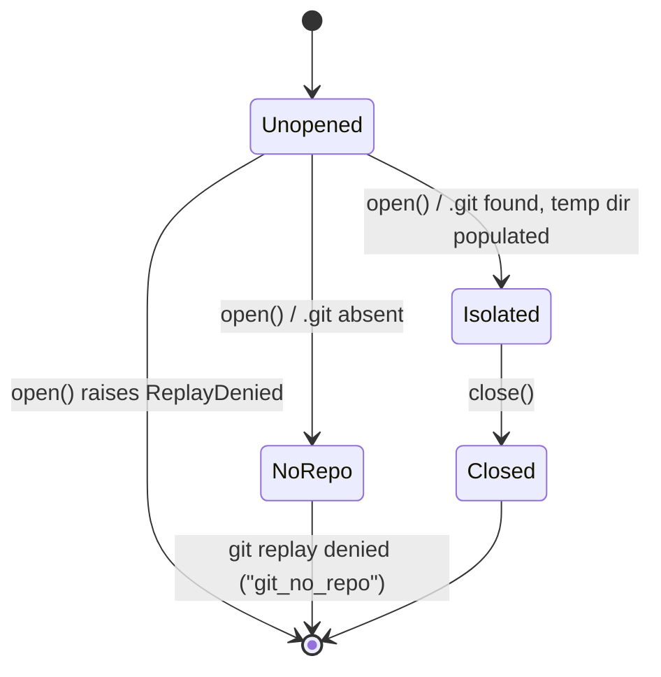
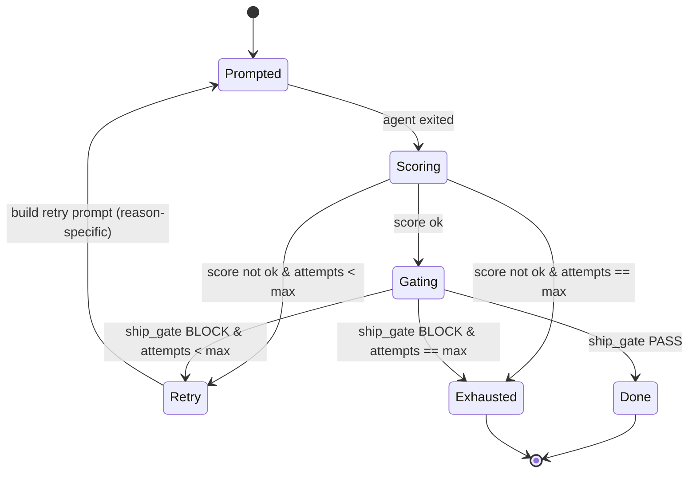
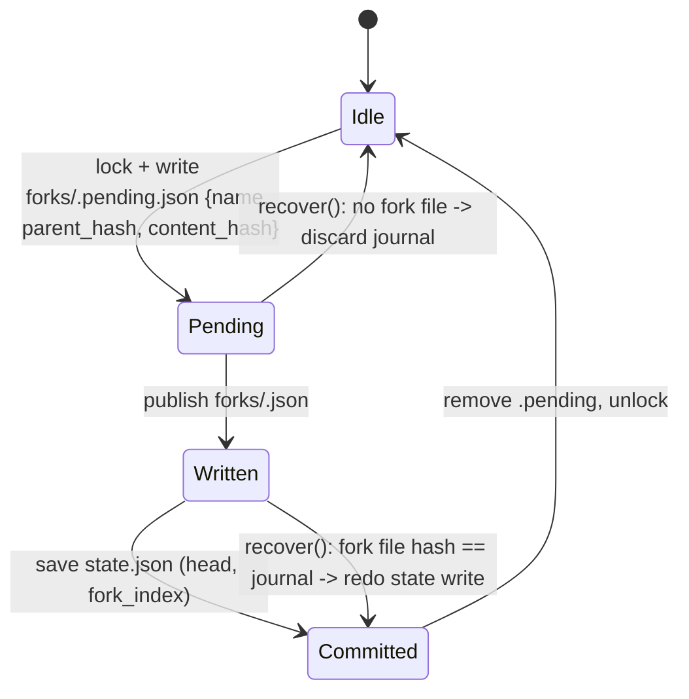

# Implicit State Machines Audit: DagzTagz public repositories

An audit of the public Python code under [github.com/DagzTagz](https://github.com/DagzTagz). It looks for lifecycles and protocols that are encoded *implicitly* (booleans, sentinel `None`s, status strings, file presence, write ordering) and should be made explicit state machines or tagged unions.

Every claim below cites `repo/path:Lstart-Lend` with a permalink to the exact commit audited. Findings marked **Reproduced** were confirmed by executing the code at that commit (scripts summarized inline). The audit itself changed nothing upstream. Fixes for all 13 findings followed on 2026-11-24 in separate pull requests (see Remediation status below); see the advisories in [`docs/security/`](../security/) here and in [vesper-bind](https://github.com/DagzTagz/vesper-bind/tree/main/docs/security).

---

## Remediation status

Updated 2026-11-24. All 13 findings are fixed and merged on `main` in each repository, with merge commits. Each repository's disclosure is in its `docs/security/state-machine-audit-2026-11.md`.

| Finding | Priority | Repo | Pull request | Merge commit | Status |
|---|---|---|---|---|---|
| F1 | High | Dagz-Scaffold | [Dagz-Scaffold#1](https://github.com/DagzTagz/Dagz-Scaffold/pull/1) | [`4f09170`](https://github.com/DagzTagz/Dagz-Scaffold/commit/4f091704b708918de37594977cfb1ea73c282785) | Merged. |
| F2 | High | vesper-bind | [vesper-bind#1](https://github.com/DagzTagz/vesper-bind/pull/1) | [`c9b4e82`](https://github.com/DagzTagz/vesper-bind/commit/c9b4e82dcdf2ce8d323f4404017180eca487f771) | Merged. |
| F3 | Med | Dagz-Scaffold | [Dagz-Scaffold#2](https://github.com/DagzTagz/Dagz-Scaffold/pull/2) | [`2574c1e`](https://github.com/DagzTagz/Dagz-Scaffold/commit/2574c1e40d9b0f17130b0169ddf6f49e7610a864) | Merged. |
| F4 | Med | vesper-runtime | [vesper-runtime#1](https://github.com/DagzTagz/vesper-runtime/pull/1) | [`e241040`](https://github.com/DagzTagz/vesper-runtime/commit/e24104020be997b48ed12db9fe1fecb52663ae90) | Merged. |
| F5 | Med | vesper-runtime | [vesper-runtime#1](https://github.com/DagzTagz/vesper-runtime/pull/1) | [`e241040`](https://github.com/DagzTagz/vesper-runtime/commit/e24104020be997b48ed12db9fe1fecb52663ae90) | Merged. |
| F6 | Med | dagztagz-hypothesis-engine | [dagztagz-hypothesis-engine#4](https://github.com/DagzTagz/dagztagz-hypothesis-engine/pull/4) | [`3a3f071`](https://github.com/DagzTagz/dagztagz-hypothesis-engine/commit/3a3f07148f7fd88aafbe8b421af0ead43701e519) | Merged. |
| F7 | Low | vesper-runtime | [vesper-runtime#1](https://github.com/DagzTagz/vesper-runtime/pull/1) | [`e241040`](https://github.com/DagzTagz/vesper-runtime/commit/e24104020be997b48ed12db9fe1fecb52663ae90) | Merged. |
| F8 | Low | Dagz-Scaffold | [Dagz-Scaffold#2](https://github.com/DagzTagz/Dagz-Scaffold/pull/2) | [`2574c1e`](https://github.com/DagzTagz/Dagz-Scaffold/commit/2574c1e40d9b0f17130b0169ddf6f49e7610a864) | Merged. |
| F9 | Low | Dagz-Scaffold | [Dagz-Scaffold#2](https://github.com/DagzTagz/Dagz-Scaffold/pull/2) | [`2574c1e`](https://github.com/DagzTagz/Dagz-Scaffold/commit/2574c1e40d9b0f17130b0169ddf6f49e7610a864) | Merged. |
| F10 | Low | dagztagz-hypothesis-engine (vesper-bind reads it) | [dagztagz-hypothesis-engine#4](https://github.com/DagzTagz/dagztagz-hypothesis-engine/pull/4) | [`3a3f071`](https://github.com/DagzTagz/dagztagz-hypothesis-engine/commit/3a3f07148f7fd88aafbe8b421af0ead43701e519) | Merged. The string values are unchanged, so vesper-bind needed no change. |
| F11 | Low | vesper-runtime and vesper-bind | [vesper-runtime#1](https://github.com/DagzTagz/vesper-runtime/pull/1) and [vesper-bind#2](https://github.com/DagzTagz/vesper-bind/pull/2) | [`e241040`](https://github.com/DagzTagz/vesper-runtime/commit/e24104020be997b48ed12db9fe1fecb52663ae90) and [`f741c36`](https://github.com/DagzTagz/vesper-bind/commit/f741c3648885a8812ea093ff0c087edca4f8fdc6) | Merged. vesper-bind does not call vesper-runtime's API, because its rules forbid vendoring vesper-runtime. The two share the documented `.lock` and note contract instead. |
| F12 | Low | vesper-runtime | [vesper-runtime#1](https://github.com/DagzTagz/vesper-runtime/pull/1) | [`e241040`](https://github.com/DagzTagz/vesper-runtime/commit/e24104020be997b48ed12db9fe1fecb52663ae90) | Merged. |
| F13 | Low | vesper-bind | [vesper-bind#1](https://github.com/DagzTagz/vesper-bind/pull/1) | [`c9b4e82`](https://github.com/DagzTagz/vesper-bind/commit/c9b4e82dcdf2ce8d323f4404017180eca487f771) | Merged. |

The line numbers and permalinks below point to the audited commits. They describe the code as it was before these fixes.

---

## 1. Scope

| Repository | Commit audited | Language | Python LOC (src, excl. tests) | Status |
|---|---|---|---|---|
| [Dagz-Scaffold](https://github.com/DagzTagz/Dagz-Scaffold/tree/76edab4b4c93e199034ca1e8fa545c27b79a0a2d) | `76edab4b4c93e199034ca1e8fa545c27b79a0a2d` | Python | ~2,260 (`harness/` minus selftests) | Scanned |
| [dagztagz-hypothesis-engine](https://github.com/DagzTagz/dagztagz-hypothesis-engine/tree/f786e9263ba73d83548bf0a4e90b19e2e22c96c6) | `f786e9263ba73d83548bf0a4e90b19e2e22c96c6` | Python ≥3.11 | ~2,860 | Scanned |
| [vesper-bind](https://github.com/DagzTagz/vesper-bind/tree/aa1e93c86bf46780106c6410effe9113b454769c) | `aa1e93c86bf46780106c6410effe9113b454769c` | Python ≥3.11 | ~1,200 | Scanned |
| [vesper-runtime](https://github.com/DagzTagz/vesper-runtime/tree/5b775d7115c5e81ebd7a98d12e1115be87e49c3b) | `5b775d7115c5e81ebd7a98d12e1115be87e49c3b` | Python ≥3.11 | ~2,620 | Scanned |
| [DagzTagz](https://github.com/DagzTagz/DagzTagz/tree/56f42b0ee9025e6e937183ffc473f105d57a5d4a) | `56f42b0ee9025e6e937183ffc473f105d57a5d4a` | (profile README + SVGs) | 0 | No code, nothing to audit |

None of the repos are forks. The account had 5 public repositories when audited.

## 2. Methodology

1. Shallow-cloned each repository read-only at its default branch HEAD.
2. Ran a candidate search with `rg` over: `status|state|phase|mode|step|stage|verdict` assignments; boolean flag clusters (`ok`, `passed`, `tainted`, `dry_run`, `in_str`, `escaped`, `closed`); sentinel-`None` fields; `for attempt`/retry loops; `while i <` hand-rolled lexers; multi-file write sequences (`_write_regular`, `os.replace`, `atomic_*`); and cross-repo string contracts (`"REJECT"`, `"ok_mock"`, `"DRY-RUN MOCK"`, `"Synthetic dry-run"`).
3. Read every candidate in context (whole function plus callers) and wrote down the states and transitions it implies.
4. Kept a finding only if the code itself shows a concrete risk: a representable impossible state, a missing guard, an unhandled transition, a non-atomic multi-step transition, or duplicated transition logic that has already drifted. Purely stylistic preferences were rejected (§5).
5. Reproduced the highest-impact claims by executing the audited code in a scratch environment (§4, per finding).

**Priority rubric.**
- **High:** a reproduced violation of a documented safety or trust invariant.
- **Med:** a reproduced or directly evidenced incorrect behavior on a realistic path (failure, interrupt, partial write).
- **Low:** impossible states are representable, or transition logic is duplicated, but no incorrect behavior was observed today.

## 3. Summary (ranked)

| # | Priority | Repo | Implicit machine | Evidenced risk |
|---|---|---|---|---|
| F1 | **High** | Dagz-Scaffold | `ReplayGitDir` lifecycle (`git_dir is None` means 3 different states) | No-`.git` checkout falls through to **enclosing repo discovery**: its config, including clean filters, executes during replay. **Reproduced** |
| F2 | **High** | vesper-bind ↔ Dagz-Scaffold | Scaffold run outcome reduced to `verdict` + dry-run marker | `bind` accepts a scaffold run with `quit_early: true` and `missing_evidence: true`, which Scaffold's scorer fails. **Reproduced** |
| F3 | Med | Dagz-Scaffold | Live run lifecycle Plan→Build→Critic→Score→Gate→Done | `run_live` returns success without the Gate state; retry branches are identical; `score.json` is mutated after it was scored |
| F4 | Med | vesper-runtime | Fork commit = 2 independent file writes, no transaction state, no lock | A failure between the writes leaves `verify --head` returning `replay` until another fork is made. Concurrent forks can lose updates. **Reproduced** |
| F5 | Med | vesper-runtime | Workspace init lifecycle (Absent→Identity→Forks→Ready) | A partial init is unrecoverable by `init` and unusable by every other command. **Reproduced** |
| F6 | Med | dagztagz-hypothesis-engine | CLI run lifecycle / audit-event protocol + progress counter | `start` events without a terminal event (output-write failure, Ctrl-C); progress `[k/N]` total is wrong when the model returns fewer hypotheses. **Reproduced** |
| F7 | Low | vesper-runtime | `VerifyResult(ok, reason, document, …)` | `ok=True, document=None` is representable, and 5 call sites defend against it. Reasons are free strings |
| F8 | Low | Dagz-Scaffold | `score.json` verdict × waivers × blockers × override | Mutual-exclusion rules enforced imperatively; override rule duplicated in `ship_gate.py` with different type checks |
| F9 | Low | Dagz-Scaffold | Three Markdown fence lexers with different semantics | The same `evidence.md` is tokenized differently by the scorer's quit-early scan and by its pairing/replay. **Reproduced** |
| F10 | Low | hypothesis-engine → vesper-bind | Retrieval outcome spread over 6 stringly-typed `meta`/`grounding` fields, derived twice | Live and mock paths emit different vocabularies; a downstream repo matches them by string suffix |
| F11 | Low | vesper-runtime / vesper-bind | Memory item tier = list membership **and** `item["tier"]` | Consistency enforced only by `schema heal`, not on the runtime load path; vesper-bind re-implements the STM transition |
| F12 | Low | vesper-runtime | `Identity(algo: str, _ecdsa_key?, _hmac_key?)` | Algo/key mismatch representable; checked at runtime in `sign_canonical` |
| F13 | Low | vesper-bind | `pass_flags` (6 booleans) | Always all-`True` by construction and by loader. The field encodes one state using 2⁶ representable values |

Counts: **2 High, 4 Med, 7 Low** (13 findings across 4 code repositories).

---

## 4. Detailed findings

Permalink prefixes used below:
- `SC` = `https://github.com/DagzTagz/Dagz-Scaffold/blob/76edab4b4c93e199034ca1e8fa545c27b79a0a2d`
- `HE` = `https://github.com/DagzTagz/dagztagz-hypothesis-engine/blob/f786e9263ba73d83548bf0a4e90b19e2e22c96c6`
- `VB` = `https://github.com/DagzTagz/vesper-bind/blob/aa1e93c86bf46780106c6410effe9113b454769c`
- `VR` = `https://github.com/DagzTagz/vesper-runtime/blob/5b775d7115c5e81ebd7a98d12e1115be87e49c3b`

### F1 (High): `ReplayGitDir` conflates "no repository", "closed" and "not yet opened"

**Locations**
- Class: [Dagz-Scaffold/harness/replay.py:L661-L756](https://github.com/DagzTagz/Dagz-Scaffold/blob/76edab4b4c93e199034ca1e8fa545c27b79a0a2d/harness/replay.py#L661-L756)
  - `env_updates` returns `{}` when `git_dir is None`: [L673-L679](https://github.com/DagzTagz/Dagz-Scaffold/blob/76edab4b4c93e199034ca1e8fa545c27b79a0a2d/harness/replay.py#L673-L679)
  - `_populate` returns early with `git_dir` still `None` when `.git` is absent: [L715-L718](https://github.com/DagzTagz/Dagz-Scaffold/blob/76edab4b4c93e199034ca1e8fa545c27b79a0a2d/harness/replay.py#L715-L718)
- Consumer: `git_spawn` [L759-L778](https://github.com/DagzTagz/Dagz-Scaffold/blob/76edab4b4c93e199034ca1e8fa545c27b79a0a2d/harness/replay.py#L759-L778) and `replay_evidence` [L861-L868](https://github.com/DagzTagz/Dagz-Scaffold/blob/76edab4b4c93e199034ca1e8fa545c27b79a0a2d/harness/replay.py#L861-L868), [L925-L927](https://github.com/DagzTagz/Dagz-Scaffold/blob/76edab4b4c93e199034ca1e8fa545c27b79a0a2d/harness/replay.py#L925-L927)
- Env: `replay_env` sets no `GIT_DIR` / `GIT_CEILING_DIRECTORIES`: [L543-L555](https://github.com/DagzTagz/Dagz-Scaffold/blob/76edab4b4c93e199034ca1e8fa545c27b79a0a2d/harness/replay.py#L543-L555)

**Implicit states** (all keyed off `(_tmp, git_dir)`):

| State | `_tmp` | `git_dir` | Meaning |
|---|---|---|---|
| Unopened | None | None | constructed, `_populate` not run |
| Isolated | set | set | temp git dir ready (the intended state) |
| NoRepo | None | None | `.git` absent at `repo_root` |
| Closed | None | None | after `close()` |

Transitions: `open()` goes Unopened→Isolated, Unopened→NoRepo, or raises `ReplayDenied`. `close()` goes Isolated→Closed.

**Evidenced risk.** Three of the four states have the same representation, so `git_spawn` cannot tell "isolated" from "not isolated". It always proceeds, with `env_updates() == {}`. Git then performs normal upward discovery from `cwd=repo_root` and uses the **enclosing** repository and its local `.git/config`. The class docstring says this must not happen ("Replaying against that directory would run them", L662-L666). The `-c` overrides at L190-L199 neutralize fsmonitor, external diff and pager, but not `filter.*.clean`.

**Reproduced.** I created `/tmp/outer` (a git repo with `filter.probe.clean` set to a command that appends to a marker file, and `.gitattributes: *.txt filter=probe`) and `/tmp/outer/inner` (no `.git`, containing a modified tracked `f.txt`). I then ran `ReplayGitDir.open(inner)` → `git_spawn(["git","diff"], inner, gd)` → `_run(...)`.
- `git_dir` was `None` and `env_updates()` was `{}`.
- `git diff` and `git diff --stat` both succeeded against the outer repository.
- The outer clean filter **executed** (marker written 4 times).

Precondition: the harness checkout has no `.git` of its own (for example, a tarball or vendored copy) and sits inside another work tree.

**Recommended design.** Make the result of `open()` a closed sum type. `git_spawn` should accept only the isolated state; the "no repo" state should be an explicit deny.



```python
from dataclasses import dataclass
from pathlib import Path
import tempfile

@dataclass(frozen=True)
class Isolated:
    root: Path
    git_dir: Path
    _tmp: tempfile.TemporaryDirectory[str]
    def env(self) -> dict[str, str]:
        return {"GIT_DIR": str(self.git_dir), "GIT_WORK_TREE": str(self.root),
                "GIT_CEILING_DIRECTORIES": str(self.root.parent)}  # belt and braces
    def close(self) -> None:
        self._tmp.cleanup()

@dataclass(frozen=True)
class NoRepo:
    root: Path

ReplayGit = Isolated | NoRepo

def git_spawn(argv: list[str], repo_root: Path, git: Isolated) -> tuple[list[str], dict[str, str]]:
    ...  # type now forbids the un-isolated case

# in replay_evidence:
match ReplayGitDir.open(repo_root):
    case NoRepo():
        raise ReplayDenied("git_no_repo")
    case Isolated() as git:
        try: spawn, env = git_spawn(argv, repo_root, git)
        finally: git.close()
```

**Priority: High.** This is a reproduced violation of the module's stated sandbox invariant (repo config must not execute during replay). The fix is small.

---

### F2 (High): vesper-bind collapses Scaffold's run outcome to `verdict` and a dry-run marker

**Locations**
- [vesper-bind/src/vesper_bind/inputs.py:L32-L80](https://github.com/DagzTagz/vesper-bind/blob/aa1e93c86bf46780106c6410effe9113b454769c/src/vesper_bind/inputs.py#L32-L80): the only gates are the dry-run markers (L39-L49) and verdict ≠ `REJECT` (L50-L60).
- Dry-run detection re-implements Scaffold string sentinels: [inputs.py:L146-L160](https://github.com/DagzTagz/vesper-bind/blob/aa1e93c86bf46780106c6410effe9113b454769c/src/vesper_bind/inputs.py#L146-L160) vs [Dagz-Scaffold/harness/score.py:L504-L508](https://github.com/DagzTagz/Dagz-Scaffold/blob/76edab4b4c93e199034ca1e8fa545c27b79a0a2d/harness/score.py#L504-L508).
- Verdict parsing re-implemented: [inputs.py:L163-L178](https://github.com/DagzTagz/vesper-bind/blob/aa1e93c86bf46780106c6410effe9113b454769c/src/vesper_bind/inputs.py#L163-L178) vs [score.py:L122-L145](https://github.com/DagzTagz/Dagz-Scaffold/blob/76edab4b4c93e199034ca1e8fa545c27b79a0a2d/harness/score.py#L122-L145).
- Scaffold's actual pass condition: `ok = not fail_reasons`, where `fail_reasons` ⊇ {`quit_early`, `REJECT`, `missing_evidence`, `evidence_has_no_commands`, `dry_run`, `task_contract_missing`, `required_verification`, `solution_not_called`, replay mismatch}. See [score.py:L491-L553](https://github.com/DagzTagz/Dagz-Scaffold/blob/76edab4b4c93e199034ca1e8fa545c27b79a0a2d/harness/score.py#L491-L553).

**Implicit states.** A Scaffold run is in one of {`Invalid` (ScoreError), `Failed(fail_reasons)`, `Passed(verdict ∈ {ACCEPT, ACCEPT WITH WAIVERS})`, `Gated` (ship-gate PASS)}. vesper-bind infers a different, coarser machine from raw files: {`DryRun`, `Rejected`, `Bindable`}. The two machines are not refinements of each other: `Failed(["quit_early","missing_evidence"])` maps to `Bindable`.

**Evidenced risk.** `rg 'quit_early|missing_evidence|fail_reasons|override' vesper-bind/src` returns nothing. So a run Scaffold fails can be bound into a receipt whose `pass_flags` say everything passed (see F13).

**Reproduced.** I copied `vesper-bind/examples/passing`, set `scaffold/score.json` `quit_early=true` and `missing_evidence=true`, and called `load_inputs(...)`. It returned `BoundInputs` with all six `pass_flags` `True`. The same `score.json` puts `quit_early` and `missing_evidence` into Scaffold's `fail_reasons` (score.py L492-L499), so Scaffold reports `ok: false`.

**Recommended design.** Make the producer emit an explicit, versioned terminal state and have the consumer check only that state. Do not re-derive it from prose. Minimal, no new dependencies:

```python
# Dagz-Scaffold: written by score.py/ship_gate.py next to score.json (or as a field in it)
from enum import StrEnum
class RunState(StrEnum):
    INVALID = "invalid"
    FAILED = "failed"
    PASSED = "passed"   # score ok
    GATED = "gated"     # ship_gate PASS (terminal success)

# vesper-bind/inputs.py
state = score.get("run_state")
if state != RunState.GATED:
    raise BindError(f"scaffold run is not gated (run_state={state!r})")
```

Until such a field exists, vesper-bind should at least fail closed on `quit_early is not False`, `missing_evidence is not False`, and REJECT-with-override, mirroring score.py L492-L499.

**Priority: High.** vesper-bind's purpose is to bind only passing inputs (its CLI help says "write one receipt when both inputs pass"), and the reproduction shows it binds a failing run.

---

### F3 (Med): Scaffold live-run loop has no explicit lifecycle; it skips the Gate state and mutates scored artifacts

**Locations**
- `live_prompt` declares the protocol "plan → builder → critic → score.py → ship_gate.py … If ship_gate.py exits non-zero, the run is not done": [Dagz-Scaffold/harness/run.py:L177-L195](https://github.com/DagzTagz/Dagz-Scaffold/blob/76edab4b4c93e199034ca1e8fa545c27b79a0a2d/harness/run.py#L177-L195) (L186-L187).
- `run_live` loop: [run.py:L255-L296](https://github.com/DagzTagz/Dagz-Scaffold/blob/76edab4b4c93e199034ca1e8fa545c27b79a0a2d/harness/run.py#L255-L296).
- `_record_attempts` rewrites `score.json` after scoring: [run.py:L238-L252](https://github.com/DagzTagz/Dagz-Scaffold/blob/76edab4b4c93e199034ca1e8fa545c27b79a0a2d/harness/run.py#L238-L252), called at L274 after `_score_dir` at L273.

**Implicit states and transitions.** `Prompted(call=1) → AgentExited → Scored(ok | not ok)`. Then:
- `Scored(ok)` → `Done(0)`
- `Scored(not ok), call<2` → `Prompted(call=2, retry)`
- otherwise → `Exhausted(1)`

**Evidenced risks**
1. **Missing state.** `run_live` returns `0` on `score ok` (L276-L280) and never runs `ship_gate` (`rg ship_gate harness/run.py` matches only the prompt text). The ship gate's extra checks (secret names/content in the run folder, symlinked artifacts, staged `runs/`; [ship_gate.py:L88-L105](https://github.com/DagzTagz/Dagz-Scaffold/blob/76edab4b4c93e199034ca1e8fa545c27b79a0a2d/harness/ship_gate.py#L88-L105), [L152-L155](https://github.com/DagzTagz/Dagz-Scaffold/blob/76edab4b4c93e199034ca1e8fa545c27b79a0a2d/harness/ship_gate.py#L152-L155)) are delegated to the agent being supervised. So the harness can report success for a run its own gate would block.
2. **Dead distinction.** The `REJECT` branch (L286-L288) and the generic branch (L289-L291) both `continue`. The retry prompt (`retry_prompt`, L198-L220) is identical either way, so `verdict` (L277) only changes a log line.
3. **Post-score mutation.** `_record_attempts` writes `attempts` into `score.json` after it was scored. The bytes that downstream tools hash (for example vesper-bind's `score_json_sha256`) are not the bytes that were scored.

**Recommended design**



```python
from dataclasses import dataclass
@dataclass(frozen=True)
class Scored:  ok: bool; reasons: tuple[str, ...]; verdict: str | None
@dataclass(frozen=True)
class Gated:   passed: bool; blocks: tuple[str, ...]

def step(attempt: int, max_calls: int, scored: Scored, gated: Gated | None) -> str:
    if not scored.ok:
        return "retry" if attempt < max_calls else "exhausted"
    if gated is None:
        return "gate"
    if gated.passed:
        return "done"
    return "retry" if attempt < max_calls else "exhausted"
```

Record `attempts` **before** scoring (or in a sidecar file) so the scored bytes are final.

**Priority: Med.** The harness's success exit code can disagree with its own documented completion criterion. Mitigation: the agent is instructed to run the gate.

---

### F4 (Med): vesper fork creation is a two-write transition without transaction state or locking

**Locations**
- `create_fork`: fork file written at [vesper-runtime/src/vesper/fork.py:L199-L202](https://github.com/DagzTagz/vesper-runtime/blob/5b775d7115c5e81ebd7a98d12e1115be87e49c3b/src/vesper/fork.py#L199-L202), then `state.json` (`head`, `forks`, `fork_index`) at [L203-L208](https://github.com/DagzTagz/vesper-runtime/blob/5b775d7115c5e81ebd7a98d12e1115be87e49c3b/src/vesper/fork.py#L203-L208). Each write is individually atomic ([L459-L473](https://github.com/DagzTagz/vesper-runtime/blob/5b775d7115c5e81ebd7a98d12e1115be87e49c3b/src/vesper/fork.py#L459-L473)); the pair is not.
- `verify_head` fails with `replay` if any valid fork file is newer than head: [fork.py:L311-L332](https://github.com/DagzTagz/vesper-runtime/blob/5b775d7115c5e81ebd7a98d12e1115be87e49c3b/src/vesper/fork.py#L311-L332).
- No file locking anywhere in the four repos (`rg 'flock|lockf|\.lock'` returns nothing).

**Implicit states** (per fork name *n*):
- `Absent`
- `Written` (forks/*n*.json exists; state.json does not reference it)
- `Committed` (state.json `head == n`, `fork_index[n] == hash`)

The code assumes `Written` is never observable.

**Evidenced risks**
1. If `save_state` fails after the fork file is published (I/O error, `assert_mode` raising at L473, process kill), the workspace is left in `Written`. `verify_head` then returns `replay` (the newer orphan file looks like a rollback of head). `export` then withholds the fork and fails the audit ([export.py:L70-L72](https://github.com/DagzTagz/vesper-runtime/blob/5b775d7115c5e81ebd7a98d12e1115be87e49c3b/src/vesper/export.py#L70-L72)). The state persists until another fork is committed.
2. Two concurrent `vesper fork` processes both read the same `head`, both write a fork file, and the last `save_state` wins. The loser's fork file remains as a newer-than-head orphan (same `replay` failure) or becomes head with a stale index.

**Reproduced.** I ran `init_workspace` and `create_fork("alpha")`, and `verify_head` returned `ok`. I then monkey-patched `save_state` to raise and called `create_fork("beta")`: it raised, and `forks/` held `alpha.json` and `beta.json`. `verify_head` then returned **`replay`**.

**Recommended design.** Make the intermediate state explicit and recoverable: write a journal before the fork file and finish or roll back on the next command. Take an exclusive lock for the duration.



```python
import fcntl, contextlib
@contextlib.contextmanager
def workspace_lock(ws):
    fd = os.open(ws.sub(".lock"), os.O_RDWR | os.O_CREAT | os.O_NOFOLLOW, 0o600)
    try:
        fcntl.flock(fd, fcntl.LOCK_EX); yield
    finally:
        os.close(fd)

def recover(ws) -> None:
    j = ws.sub(FORKS_DIRNAME, ".pending.json")
    if not j.exists(): return
    pending = loads_strict(j.read_text())
    fork = ws.sub(FORKS_DIRNAME, f"{pending['name']}.json")
    if fork.exists() and verify_fork_file(fork, ...).content_hash == pending["content_hash"]:
        _commit_state(ws, pending)          # Written -> Committed
    j.unlink()                               # Pending -> Idle
```

**Priority: Med.** The failure is reproducible with a single I/O error and breaks `verify --head` and `export`. It is recoverable by hand.

---

### F5 (Med): Workspace initialization has unrecoverable partial states

**Locations**
- [vesper-runtime/src/vesper/fork.py:L121-L132](https://github.com/DagzTagz/vesper-runtime/blob/5b775d7115c5e81ebd7a98d12e1115be87e49c3b/src/vesper/fork.py#L121-L132): `identity/` generated → `forks/` created → `state.json` written.
- Re-init guard: [fork.py:L123-L124](https://github.com/DagzTagz/vesper-runtime/blob/5b775d7115c5e81ebd7a98d12e1115be87e49c3b/src/vesper/fork.py#L123-L124). `create_private_dir` refuses reuse: [paths.py:L180-L185](https://github.com/DagzTagz/vesper-runtime/blob/5b775d7115c5e81ebd7a98d12e1115be87e49c3b/src/vesper/paths.py#L180-L185). `load_state` needs `state.json`: [fork.py:L135-L144](https://github.com/DagzTagz/vesper-runtime/blob/5b775d7115c5e81ebd7a98d12e1115be87e49c3b/src/vesper/fork.py#L135-L144).

**Implicit states:** `Absent` → `IdentityOnly` → `IdentityAndForks` → `Ready(head=None)` → `Ready(head=name)`. Presence checks are scattered across `init_workspace`, `create_private_dir`, `load_identity` and `load_state`; no function classifies the workspace.

**Evidenced risk.** A failure after `generate_identity` leaves `IdentityOnly` or `IdentityAndForks`. In both states `init` refuses ("identity already exists") and every other command fails ("state file is missing"), with no repair path short of deleting files by hand. Separately, `state.json` is written with `os.replace`, so a directory containing a stray `state.json` but no `identity/` or `forks/` has its state silently overwritten by `init`.

**Reproduced.** I made `_write_regular` raise during `init_workspace`. The directory was left with `['forks', 'identity']`. A second `init_workspace` raised `IOPermissionError: identity already exists`, and `load_state` raised `IOPermissionError: state file is missing`.

**Recommended design**

```python
from enum import Enum, auto
class WsState(Enum):
    ABSENT = auto(); PARTIAL = auto(); READY = auto(); FOREIGN = auto()

def classify(root: Path) -> WsState:
    has = {n: (root / n).exists() for n in (IDENTITY_DIRNAME, FORKS_DIRNAME, STATE_FILENAME)}
    if not any(has.values()):
        return WsState.ABSENT
    if all(has.values()):
        return WsState.READY
    if has[STATE_FILENAME] and not has[IDENTITY_DIRNAME]:
        return WsState.FOREIGN   # never overwrite
    return WsState.PARTIAL

# init: ABSENT -> build in root/.init-<rand>/ then rename each piece; write state.json LAST
#       PARTIAL -> refuse with an explicit "run `vesper init --resume`" message (or resume)
#       READY/FOREIGN -> refuse
```

Writing a `.init-in-progress` marker first and removing it last gives the same property with less code.

**Priority: Med.** Any I/O error during first-run setup leaves a workspace that no command can use or repair, and the failure was reproduced.

---

### F6 (Med): Hypothesis-engine run lifecycle is implicit in audit events and a progress counter

**Locations**
- Audit events `aborted`/`start`/`error`/`complete` emitted ad hoc in `main`: [dagztagz-hypothesis-engine/src/hypothesis_engine/cli.py:L206-L303](https://github.com/DagzTagz/dagztagz-hypothesis-engine/blob/f786e9263ba73d83548bf0a4e90b19e2e22c96c6/src/hypothesis_engine/cli.py#L206-L303)
  - `start` [L223-L236](https://github.com/DagzTagz/dagztagz-hypothesis-engine/blob/f786e9263ba73d83548bf0a4e90b19e2e22c96c6/src/hypothesis_engine/cli.py#L223-L236)
  - `except Exception` [L259-L275](https://github.com/DagzTagz/dagztagz-hypothesis-engine/blob/f786e9263ba73d83548bf0a4e90b19e2e22c96c6/src/hypothesis_engine/cli.py#L259-L275)
  - output write returns before any terminal event [L280-L286](https://github.com/DagzTagz/dagztagz-hypothesis-engine/blob/f786e9263ba73d83548bf0a4e90b19e2e22c96c6/src/hypothesis_engine/cli.py#L280-L286)
  - `complete` [L288-L303](https://github.com/DagzTagz/dagztagz-hypothesis-engine/blob/f786e9263ba73d83548bf0a4e90b19e2e22c96c6/src/hypothesis_engine/cli.py#L288-L303)
- Progress counter: `total = estimate_api_calls(n_hypotheses)` fixed before generation; loop runs over actual hypotheses. See [workflow.py:L117-L123](https://github.com/DagzTagz/dagztagz-hypothesis-engine/blob/f786e9263ba73d83548bf0a4e90b19e2e22c96c6/src/hypothesis_engine/workflow.py#L117-L123), [L154-L164](https://github.com/DagzTagz/dagztagz-hypothesis-engine/blob/f786e9263ba73d83548bf0a4e90b19e2e22c96c6/src/hypothesis_engine/workflow.py#L154-L164). `_step_generate` may return fewer than `n` (skips bad rows): [L292-L305](https://github.com/DagzTagz/dagztagz-hypothesis-engine/blob/f786e9263ba73d83548bf0a4e90b19e2e22c96c6/src/hypothesis_engine/workflow.py#L292-L305).

**Implicit states:** `Confirming → (Aborted | Started) → Running(step k of N) → (Errored | Produced) → (OutputWritten | OutputFailed) → Completed`. Only `Aborted`, `Started`, `Errored` and `Completed` emit events, and the terminal event is not guaranteed after `Started`.

**Evidenced risks**
1. **Orphaned `start`.**
   - If `-o` cannot be written, `main` returns 1 at L286 after logging `start` but no `error`/`complete`.
   - `except Exception` does not catch `KeyboardInterrupt` (a `BaseException`), so Ctrl-C during a long live run (the banner tells users each step can take "tens of seconds") also leaves `start` without a terminal event.
2. **Progress lies.** With `n=2` and one unusable model row, progress ends at `[4/6]`.

**Reproduced.**
- `python -m hypothesis_engine "probe topic" --dry-run --audit-log audit.jsonl -o out.json` with `out.json` a symlink: exit 1; `audit.jsonl` contains only `start`.
- A stubbed `chat_json` returning one valid and one statement-less hypothesis for `n=2`: the progress lines were `[1/6] … [4/6]`, with no `[5/6]` or `[6/6]`.

**Recommended design.** Make the terminal event structural (exactly one per `start`) and derive `total` after generation:

```python
from enum import StrEnum
class Outcome(StrEnum):
    COMPLETE = "complete"; ERROR = "error"; INTERRUPTED = "interrupted"; OUTPUT_FAILED = "output_failed"

def run_with_audit(audit_path, start_fields, body) -> int:
    if _audit_checked(err, audit_path, {"event": "start", **start_fields}):
        return 1
    outcome, extra, code = Outcome.ERROR, {}, 1
    try:
        extra, code = body()          # returns (fields, exit code); raises on failure
        outcome = Outcome.COMPLETE if code == 0 else Outcome.OUTPUT_FAILED
    except KeyboardInterrupt:
        outcome, code = Outcome.INTERRUPTED, 130; raise
    except Exception as exc:
        extra = {"error_type": type(exc).__name__, "error": _friendly_error(exc)}
    finally:
        _audit_checked(err, audit_path, {"event": outcome.value, **start_fields, **extra})
    return code

# workflow: after _step_generate
total = 2 + 2 * len(hypotheses)
```

**Priority: Med.** The audit log is a user-facing feature, and its event sequence is reproducibly incomplete on two ordinary paths (an unwritable `-o` and Ctrl-C).

---

### F7 (Low): `VerifyResult` is a product type standing in for a sum type

**Locations**
- [vesper-runtime/src/vesper/fork.py:L66-L73](https://github.com/DagzTagz/vesper-runtime/blob/5b775d7115c5e81ebd7a98d12e1115be87e49c3b/src/vesper/fork.py#L66-L73) (`ok: bool, reason: str, waivers, document: dict | None, content_hash: str = "", signature_prefix`)
- Defensive `not r.ok or r.document is None` checks at [L173](https://github.com/DagzTagz/vesper-runtime/blob/5b775d7115c5e81ebd7a98d12e1115be87e49c3b/src/vesper/fork.py#L173), [L305](https://github.com/DagzTagz/vesper-runtime/blob/5b775d7115c5e81ebd7a98d12e1115be87e49c3b/src/vesper/fork.py#L305), [L326](https://github.com/DagzTagz/vesper-runtime/blob/5b775d7115c5e81ebd7a98d12e1115be87e49c3b/src/vesper/fork.py#L326), [L369](https://github.com/DagzTagz/vesper-runtime/blob/5b775d7115c5e81ebd7a98d12e1115be87e49c3b/src/vesper/fork.py#L369), and `getattr`-based checks in [export.py:L607-L610](https://github.com/DagzTagz/vesper-runtime/blob/5b775d7115c5e81ebd7a98d12e1115be87e49c3b/src/vesper/export.py#L607-L610)
- Reasons are free strings across [L219-L285](https://github.com/DagzTagz/vesper-runtime/blob/5b775d7115c5e81ebd7a98d12e1115be87e49c3b/src/vesper/fork.py#L219-L285), [L336-L378](https://github.com/DagzTagz/vesper-runtime/blob/5b775d7115c5e81ebd7a98d12e1115be87e49c3b/src/vesper/fork.py#L336-L378): `name`, `parent_missing`, `canonical`, `bad_signature`, `schema_id`, `state_hash`, `kid`, `parent_hash`, `cycle`, `replay`, `no_head`, `ok`. `_check_parent` returns a parallel `(bool, str, list)` triple.

**Representable impossible states:** `ok=True` with `document=None` or `content_hash=""`; `ok=False` with `reason="ok"`; `ok=True` with a failure reason. No current constructor produces these (no bug), but every consumer re-checks.

**Sketch**

```python
from enum import StrEnum
from dataclasses import dataclass
class Reject(StrEnum):
    NAME="name"; PARENT_MISSING="parent_missing"; CANONICAL="canonical"; BAD_SIGNATURE="bad_signature"
    SCHEMA_ID="schema_id"; STATE_HASH="state_hash"; KID="kid"; PARENT_HASH="parent_hash"
    CYCLE="cycle"; REPLAY="replay"; NO_HEAD="no_head"

@dataclass(frozen=True)
class Verified:  document: dict; content_hash: str; signature_prefix: str; waivers: tuple[dict[str,str], ...] = ()
@dataclass(frozen=True)
class Rejected:  reason: Reject; signature_prefix: str = ""

VerifyResult = Verified | Rejected
```

**Priority: Low.** No incorrect behavior today. The change removes five defensive checks and makes the CLI's error surface (`CryptoError(result.reason)`, [cli.py:L240-L241](https://github.com/DagzTagz/vesper-runtime/blob/5b775d7115c5e81ebd7a98d12e1115be87e49c3b/src/vesper/cli.py#L240-L241)) exhaustively typed.

---

### F8 (Low): `score.json` verdict/waivers/blockers/override form an unmodelled state matrix

**Locations**
- Schema allows every combination: `verdict` enum, independent `waivers[]`, optional `override` ([harness/schema/run.schema.json:L44-L97](https://github.com/DagzTagz/Dagz-Scaffold/blob/76edab4b4c93e199034ca1e8fa545c27b79a0a2d/harness/schema/run.schema.json#L44-L97)).
- Exclusion rules enforced imperatively: [score.py:L444-L458](https://github.com/DagzTagz/Dagz-Scaffold/blob/76edab4b4c93e199034ca1e8fa545c27b79a0a2d/harness/score.py#L444-L458) (ACCEPT ⇒ no waivers; AWW ⇒ ≥1 waiver; non-REJECT ⇒ no BLOCKERS; REJECT ⇒ ≥1 BLOCKER).
- Override rule implemented twice: [score.py:L266-L279](https://github.com/DagzTagz/Dagz-Scaffold/blob/76edab4b4c93e199034ca1e8fa545c27b79a0a2d/harness/score.py#L266-L279) (requires `isinstance(by, str)`), [ship_gate.py:L146-L151](https://github.com/DagzTagz/Dagz-Scaffold/blob/76edab4b4c93e199034ca1e8fa545c27b79a0a2d/harness/ship_gate.py#L146-L151) (uses `str(ov.get("by"))`, which accepts non-strings).
- vesper-runtime emits its own `critic.md`/`score.json` with the same verdict vocabulary but a different score shape (`pass`, `checks`) via two separate verdict functions: [export.py:L534-L587](https://github.com/DagzTagz/vesper-runtime/blob/5b775d7115c5e81ebd7a98d12e1115be87e49c3b/src/vesper/export.py#L534-L587).

**Representable impossible states:** `override` present on a non-REJECT verdict (accepted silently); ACCEPT plus waivers (accepted by the schema, rejected later by code).

**Why not a bug today.** A malformed override still fails in score.py, and ship_gate copies score's `fail_reasons` first (L143-L144), so the looser ship-gate check never decides alone. That safety depends on call order, not on the type.

**Sketch.** Encode the verdict as a JSON Schema `oneOf`, mirrored by a Python union:

```python
@dataclass(frozen=True)
class Accept:            pass
@dataclass(frozen=True)
class AcceptWithWaivers: waivers: tuple[Waiver, ...]          # len >= 1, enforced in __post_init__
@dataclass(frozen=True)
class Reject:            blockers: tuple[str, ...]; override: Override | None = None
Verdict = Accept | AcceptWithWaivers | Reject

def gate_passes(v: Verdict, *, honor_override: bool) -> bool:
    match v:
        case Accept() | AcceptWithWaivers(): return True
        case Reject(override=Override(by=b, reason=r)) if honor_override and b.strip() and r.strip(): return True
        case Reject(): return False
```

Have ship_gate.py import `gate_passes` instead of re-implementing it.

**Priority: Low.** The rules are enforced today. The finding is about the duplication that has already drifted between score.py and ship_gate.py.

---

### F9 (Low): Three Markdown fence lexers with divergent semantics over the same `evidence.md`

**Locations**
- Regex lexer A: [task_contract.py:L26-L28](https://github.com/DagzTagz/Dagz-Scaffold/blob/76edab4b4c93e199034ca1e8fa545c27b79a0a2d/harness/task_contract.py#L26-L28) (`^```([^\n]*)\n(.*?)````). The closer is not line-anchored and there is no tick-count matching. Used for command counting, red-then-green, required-verification and pairing ([score.py:L250-L263](https://github.com/DagzTagz/Dagz-Scaffold/blob/76edab4b4c93e199034ca1e8fa545c27b79a0a2d/harness/score.py#L250-L263), [L375-L390](https://github.com/DagzTagz/Dagz-Scaffold/blob/76edab4b4c93e199034ca1e8fa545c27b79a0a2d/harness/score.py#L375-L390)).
- Regex lexer B (same pattern, with spans): [replay.py:L28](https://github.com/DagzTagz/Dagz-Scaffold/blob/76edab4b4c93e199034ca1e8fa545c27b79a0a2d/harness/replay.py#L28), used by `extract_pairs` [L445-L483](https://github.com/DagzTagz/Dagz-Scaffold/blob/76edab4b4c93e199034ca1e8fa545c27b79a0a2d/harness/replay.py#L445-L483).
- Line-state lexer C: `_parse_fence`/`_skip_fence_body`/`strip_markdown_fences` with tick counts and info strings, using an implicit `closed` mode flag. See [score.py:L165-L212](https://github.com/DagzTagz/Dagz-Scaffold/blob/76edab4b4c93e199034ca1e8fa545c27b79a0a2d/harness/score.py#L165-L212). Used for the quit-early scan ([L215-L220](https://github.com/DagzTagz/Dagz-Scaffold/blob/76edab4b4c93e199034ca1e8fa545c27b79a0a2d/harness/score.py#L215-L220)).

**Reproduced.**
- For ``"````markdown\n```\ninner\n```\n````\nafter\n"``, lexer C correctly strips the whole 4-tick block (`'after\n'`). Lexer A yields two bogus fences `[('`markdown', ''), ('', '')]`.
- For a body line ``say ``` mid-line``, lexer A truncates the fence body at the inline backticks (`'say '`).

So one document is tokenized two different ways inside one scoring pass.

**Sketch.** Use one explicit line-mode lexer (lexer C already is one) that returns spans, and derive everything else from it:

```python
from dataclasses import dataclass
@dataclass(frozen=True)
class Fence: info: str; body: str; start: int; end: int; ticks: int

def lex_fences(text: str) -> list[Fence]:
    # states: OUTSIDE -> (opener) -> INSIDE(ticks, info) -> (closer with >= ticks, empty info) -> OUTSIDE
    ...
extract_fences = lambda t: [(f.info, f.body) for f in lex_fences(t)]
```

**Priority: Low.** The divergence was reproduced but needs nested or inline backticks in evidence. It affects scoring heuristics rather than a security boundary.

---

### F10 (Low): Retrieval outcome is a stringly-typed state spread over six fields and derived twice

**Locations**
- Live: [workflow.py:L125-L142](https://github.com/DagzTagz/dagztagz-hypothesis-engine/blob/f786e9263ba73d83548bf0a4e90b19e2e22c96c6/src/hypothesis_engine/workflow.py#L125-L142), [L166-L188](https://github.com/DagzTagz/dagztagz-hypothesis-engine/blob/f786e9263ba73d83548bf0a4e90b19e2e22c96c6/src/hypothesis_engine/workflow.py#L166-L188). Fields: `retrieval`, `retrieval_backend`, `retrieval_status ∈ {skipped, ok, empty}`, `n_passages`, `background_mode ∈ {local_retrieval+model, local_retrieval_empty, model_knowledge_only}`, `retrieval_warnings`.
- Mock: [workflow.py:L698-L716](https://github.com/DagzTagz/dagztagz-hypothesis-engine/blob/f786e9263ba73d83548bf0a4e90b19e2e22c96c6/src/hypothesis_engine/workflow.py#L698-L716), [L780-L812](https://github.com/DagzTagz/dagztagz-hypothesis-engine/blob/f786e9263ba73d83548bf0a4e90b19e2e22c96c6/src/hypothesis_engine/workflow.py#L780-L812). Here `retrieval_status ∈ {skipped, ok, ok_mock}`, `retrieval_backend` can be `mock`, and `background_mode` has only 2 values.
- `BackgroundBrief.grounding: str` (documented `model_only | retrieved | mixed`), normalized at [workflow.py:L246-L265](https://github.com/DagzTagz/dagztagz-hypothesis-engine/blob/f786e9263ba73d83548bf0a4e90b19e2e22c96c6/src/hypothesis_engine/workflow.py#L246-L265); model at [models.py:L75-L78](https://github.com/DagzTagz/dagztagz-hypothesis-engine/blob/f786e9263ba73d83548bf0a4e90b19e2e22c96c6/src/hypothesis_engine/models.py#L75-L78). The sibling enums `Verdict`, `CheckStatus` and `Confidence` *are* explicit (L19-L42).
- Downstream consumer matches strings: [vesper-bind/src/vesper_bind/inputs.py:L112-L143](https://github.com/DagzTagz/vesper-bind/blob/aa1e93c86bf46780106c6410effe9113b454769c/src/vesper_bind/inputs.py#L112-L143) (`value == "ok_mock" or value.endswith("_mock")`, `startswith("mock://")`).

**Inferred machine:** `Off | Ran(Empty | Hits(passages)) | MockFilled(passages)`, crossed with grounding. Representable nonsense includes `retrieval="off"` with `n_passages>0` (if any writer slips), and `grounding="retrieved"` with `sources=[]`. The live/mock vocabularies already differ, and a separate repo depends on the exact spellings.

**Sketch**

```python
from enum import StrEnum
class Retrieval(StrEnum):
    OFF = "skipped"; EMPTY = "empty"; OK = "ok"; MOCK_FILLED = "ok_mock"
class Grounding(StrEnum):
    MODEL_ONLY = "model_only"; RETRIEVED = "retrieved"; MIXED = "mixed"

def retrieval_meta(state: Retrieval, passages: list, warnings: list[str]) -> dict:
    """Single source for all six meta fields (used by live and mock paths)."""
    ...
```

Export `Retrieval` values as a documented contract that vesper-bind can pin.

**Priority: Low.** No wrong output was observed. The risk is drift between the live and mock vocabularies and the string-matching consumer.

---

### F11 (Low): Memory tier encoded twice; tier transitions duplicated across repos

**Locations**
- Item carries `tier` and also lives in `memory[tier]`: [vesper-runtime/src/vesper/memory.py:L78-L133](https://github.com/DagzTagz/vesper-runtime/blob/5b775d7115c5e81ebd7a98d12e1115be87e49c3b/src/vesper/memory.py#L78-L133). Promotion rewrites both: [L238-L253](https://github.com/DagzTagz/vesper-runtime/blob/5b775d7115c5e81ebd7a98d12e1115be87e49c3b/src/vesper/memory.py#L238-L253).
- The tier/list consistency check exists only in `heal`: [schema.py:L250-L257](https://github.com/DagzTagz/vesper-runtime/blob/5b775d7115c5e81ebd7a98d12e1115be87e49c3b/src/vesper/schema.py#L250-L257). The runtime path `load_state` checks only that `memory` is a dict: [fork.py:L135-L144](https://github.com/DagzTagz/vesper-runtime/blob/5b775d7115c5e81ebd7a98d12e1115be87e49c3b/src/vesper/fork.py#L135-L144).
- vesper-bind re-implements the STM append, cap-100 eviction and id derivation outside vesper-runtime: [vesper-bind/src/vesper_bind/note.py:L44-L59](https://github.com/DagzTagz/vesper-bind/blob/aa1e93c86bf46780106c6410effe9113b454769c/src/vesper_bind/note.py#L44-L59), [L97-L99](https://github.com/DagzTagz/vesper-bind/blob/aa1e93c86bf46780106c6410effe9113b454769c/src/vesper_bind/note.py#L97-L99) vs [memory.py:L96-L98](https://github.com/DagzTagz/vesper-runtime/blob/5b775d7115c5e81ebd7a98d12e1115be87e49c3b/src/vesper/memory.py#L96-L98), [L128-L132](https://github.com/DagzTagz/vesper-runtime/blob/5b775d7115c5e81ebd7a98d12e1115be87e49c3b/src/vesper/memory.py#L128-L132).
- vesper-bind's prepare/commit reads state at prepare time and writes those bytes at commit time with no compare-and-swap: [note.py:L25-L81](https://github.com/DagzTagz/vesper-bind/blob/aa1e93c86bf46780106c6410effe9113b454769c/src/vesper_bind/note.py#L25-L81), [cli.py:L119-L153](https://github.com/DagzTagz/vesper-bind/blob/aa1e93c86bf46780106c6410effe9113b454769c/src/vesper_bind/cli.py#L119-L153). A `vesper remember` in that window is lost (no lock; see F4).

**Tier transition table** (as implemented in `sleep_state` and `remember`):

| From | Event | To |
|---|---|---|
| (new) | remember(tier=t) | t ∈ {stm, semantic, ltm} |
| stm | overflow (>100, oldest `(ts,id)`) | dropped |
| stm | sleep, score ≥ 0.45 or pinned | ltm |
| semantic | sleep, weight < 0.02 ∧ valence < 0.4 ∧ ¬pinned | dropped |
| semantic | sleep, score ≥ 0.45 or pinned | ltm |
| ltm | sleep, same id | compacted (max weight) |

**Sketch.** Make list membership the single source of truth: drop `item["tier"]` from storage, or validate it in `load_state`. Expose `remember`/`STM_CAP` as the only writer API that vesper-bind calls (or vendors with a version pin), and add an expected-hash check in `commit_note`:

```python
def commit_note(workspace: Path, data: bytes, expected_sha256: str) -> None:
    current = read_regular(state_path)
    if current.sha256 != expected_sha256:
        raise BindError("workspace state changed during bind")
    atomic_replace(root, "state.json", data)
```

**Priority: Low.** No incorrect behavior observed through the supported CLI. The risks are on hand-edited state and in the short concurrent window.

---

### F12 (Low): `Identity` encodes algorithm choice as a string plus two nullable keys

**Locations**
- [vesper-runtime/src/vesper/crypto.py:L95-L131](https://github.com/DagzTagz/vesper-runtime/blob/5b775d7115c5e81ebd7a98d12e1115be87e49c3b/src/vesper/crypto.py#L95-L131) (`algo: str`, `public_key_hex: str | None`, `_ecdsa_key: object | None`, `_hmac_key: bytes | None`). `sign_canonical` re-checks `None` per branch (L120, L128) and has a fallthrough `unknown signature algorithm` (L131).
- Constructed positionally at [L268](https://github.com/DagzTagz/vesper-runtime/blob/5b775d7115c5e81ebd7a98d12e1115be87e49c3b/src/vesper/crypto.py#L268), [L275](https://github.com/DagzTagz/vesper-runtime/blob/5b775d7115c5e81ebd7a98d12e1115be87e49c3b/src/vesper/crypto.py#L275), [L308](https://github.com/DagzTagz/vesper-runtime/blob/5b775d7115c5e81ebd7a98d12e1115be87e49c3b/src/vesper/crypto.py#L308).

**Representable impossible states:** `algo="ecdsa-p256"` with `_ecdsa_key=None`; both keys set; an unknown `algo`.

**Sketch**

```python
@dataclass(frozen=True)
class EcdsaIdentity:  kid: str; public_key_hex: str; public_doc: dict; _key: object = field(repr=False)
@dataclass(frozen=True)
class HmacIdentity:   kid: str; public_doc: dict; _key: bytes = field(repr=False)
Identity = EcdsaIdentity | HmacIdentity
```

**Priority: Low.** The runtime checks prevent misuse today. This is type hygiene for security-sensitive code.

---

### F13 (Low): `pass_flags` are six booleans that can only be `True`

**Locations**
- Built as literal `True`s: [vesper-bind/src/vesper_bind/inputs.py:L62-L71](https://github.com/DagzTagz/vesper-bind/blob/aa1e93c86bf46780106c6410effe9113b454769c/src/vesper_bind/inputs.py#L62-L71). The guard `not all(flags.values())` at L70 is unreachable.
- Loader rejects any `False`: [receipt.py:L180-L185](https://github.com/DagzTagz/vesper-bind/blob/aa1e93c86bf46780106c6410effe9113b454769c/src/vesper_bind/receipt.py#L180-L185).

**Observation.** The real state ("all gates passed") is conveyed by the absence of a `BindError`. The flags are a 2⁶-valued encoding of one state, and they can claim checks that were never performed (F2: no `quit_early` check stands behind `critic_not_reject`).

**Sketch.** Replace with an explicit, version-pinned enumeration of the gates actually evaluated, for example `"gates": ["hypothesis_not_dry_run", …, "scaffold_run_state=gated"]`. Or keep the booleans but compute each one from the corresponding check result rather than a literal.

**Priority: Low.** No incorrect behavior beyond what F2 already covers. This is honesty of the receipt format.

---

## 5. Candidates considered and rejected

| Location | Why rejected |
|---|---|
| `hypothesis_engine/llm.py` `chat_json` retry loop ([L42-L71](https://github.com/DagzTagz/dagztagz-hypothesis-engine/blob/f786e9263ba73d83548bf0a4e90b19e2e22c96c6/src/hypothesis_engine/llm.py#L42-L71)) | Bounded `for attempt in range(...)`, with the attempt index as the only state. Explicit enough |
| `llm.py` JSON repair scanners `_repair_invalid_escapes_in_strings` / `_strip_trailing_commas_outside_strings` ([L120-L193](https://github.com/DagzTagz/dagztagz-hypothesis-engine/blob/f786e9263ba73d83548bf0a4e90b19e2e22c96c6/src/hypothesis_engine/llm.py#L120-L193)) | Two-state (`in_str`, `escaped`) lexers, local and correct on inspection (escape pairs consumed atomically; `\uXXXX` bounds right). An enum would not reduce risk |
| `hypothesis_engine/models.py` `Verdict`, `CheckStatus`, `Confidence` | Already explicit `StrEnum`s with fail-safe parsers (`_parse_verdict` → `NEEDS_REVISION`, `_parse_check_status` → `UNCLEAR`) |
| `hypothesis_engine/workflow.py` `run_workflow` pipeline | Linear, exception-terminated pipeline with no re-entry or branching beyond `dry_run`. Only its progress/audit edges are flagged (F6) |
| `hypothesis_engine/cli.py` `_confirm_live` | Pure decision tree over inputs (trusted host, `--yes`, TTY, typed `YES`); no persistent state |
| `vesper/crypto.py` `_load_ecdsa` tri-state global (`None`/`False`/`dict`) | Classic memoized optional import; all three states handled at L50-L53 |
| `vesper/memory.py` `sleep_state` | Ordered, documented consolidation pipeline (module docstring L3-L15); the transitions are in one function. Tier representation is flagged separately (F11) |
| `vesper/export.py` `export_audit` write→scan→rewrite→rescan ([L77-L118](https://github.com/DagzTagz/vesper-runtime/blob/5b775d7115c5e81ebd7a98d12e1115be87e49c3b/src/vesper/export.py#L77-L118)) | Bounded straight-line sequence that only moves toward `passed=False`. Fail-closed and readable as is |
| `vesper/cli.py` `_dispatch` / `vesper_bind/cli.py` `_dispatch` | Command routers, not stateful |
| `Dagz-Scaffold/harness/replay.py` per-pair `_record(action=…)` dicts | `action` plus co-varying `exit`/`expected_exit`/`match` is a candidate union, but each record is produced once and only serialized. Worth folding into the F1 refactor, but no defect |
| `Dagz-Scaffold/harness/score.py` `derive_scores` | Pure monotone `min()` caps; no state is carried between calls |
| `Dagz-Scaffold/harness/ship_gate.py` `git_index_blocks` | Explicit fail-closed mapping of git errors to block reasons |
| `vesper_bind/paths.py` `atomic_create` (`linked` flag) | One-bit compensating-action flag, correct (`link(2)` then unlink on failure) |
| `DagzTagz/DagzTagz` | Profile README and SVG assets only; no code |

## 6. Limitations

- **Static and point-in-time.** The audit covers the five default-branch HEADs listed in §1. Other branches, tags and history were not reviewed.
- **Python sources only.** Markdown agent instructions (`.grok/`, `AGENTS.md`), CI workflows and JSON fixtures were read only where code depends on them.
- **Reproductions used fault injection** (monkey-patching a write to raise) to stand in for I/O failures or crashes. F1 was reproduced end to end with a real enclosing repository and git clean filter.
- **Concurrency claims** (F4, F11) are based on the absence of any locking primitive in the code plus the read-modify-write structure. No multi-process race was run.
- **No dynamic coverage.** The test suites were not run, and findings were not cross-checked against them except where noted.
- **Line numbers** refer to the audited SHAs. Permalinks stay valid even after the code changes.

## 7. Addendum, 2026-11-25: residual items from the shared-compute review

After the 13 findings above were fixed, a follow-up review asked what the pre-patch and patched code could do on shared compute: shared runners and CI, agentic workflows across an org, shared filesystems, and several agents under one account. It found no GPU-related code in any repository. It did find five residual items that the fixes above did not cover. They are listed here with their pull requests. **All of them are now merged.**

| Item | Repo | What was left | Pull request | Breaking? | Status |
|---|---|---|---|---|---|
| S13 | Dagz-Scaffold | `score.py --replay` allowed `from harness_tmp import ...`, which runs a module from the checkout as the scorer. A planted `harness_tmp.py` ran on every replay. Documented, but on by default. | [Dagz-Scaffold#4](https://github.com/DagzTagz/Dagz-Scaffold/pull/4), merge [`855df49`](https://github.com/DagzTagz/Dagz-Scaffold/commit/855df499889a3f2ecc385fc50d7d6be5e030e595) (fix [`64196e3`](https://github.com/DagzTagz/Dagz-Scaffold/commit/64196e38eead310aec6e48ad95186afd04168c89)) | Yes: refused unless `--allow-harness-tmp` | Merged |
| S14 | Dagz-Scaffold | `ship_gate.py --git-checks` and the task-file `HEAD` check still ran plain `git`. For a copy with no `.git` inside another repository, the gate reported another project's staged files and missed a staged live run at a nested path. Not in the original audit. | [Dagz-Scaffold#5](https://github.com/DagzTagz/Dagz-Scaffold/pull/5), merge [`f197cda`](https://github.com/DagzTagz/Dagz-Scaffold/commit/f197cda2549a6f46fd1d6227b3c323731f843704) (fix [`81a1d26`](https://github.com/DagzTagz/Dagz-Scaffold/commit/81a1d2682a13675842399b108757581ff9a8b96d)) | Yes: `--git-checks` and the live loop need a real clone | Merged |
| S7 (scorer side) | Dagz-Scaffold | The scorer's JSON could not be told apart from a hand-written copy. | [Dagz-Scaffold#6](https://github.com/DagzTagz/Dagz-Scaffold/pull/6), merge [`ad8d55c`](https://github.com/DagzTagz/Dagz-Scaffold/commit/ad8d55ce9ff088b4483ce0d092819d27b59e05b6) (fix [`5ee67b8`](https://github.com/DagzTagz/Dagz-Scaffold/commit/5ee67b8194d3414ff2a200f1aee00aca744f6b2c)) adds `score.py --attest-key` (HMAC-SHA256) | No | Merged |
| S7 (binder side) | vesper-bind | `bind` trusted a plain `score-result.json`. Swapping `evidence.md` for one line and typing a matching result by hand was still bound. | [vesper-bind#4](https://github.com/DagzTagz/vesper-bind/pull/4), merge [`b2f059a`](https://github.com/DagzTagz/vesper-bind/commit/b2f059ab3adc05f0ab4925a0af87d93646bc7e36) (fix [`36fbb2c`](https://github.com/DagzTagz/vesper-bind/commit/36fbb2c049ff1353c74aa5814e9ff59d506fedf3)) requires the attestation and a scorer key | Yes: `--scorer-key` or `DAGZ_SCORER_KEY_FILE`, and re-scoring | Merged |
| S15 (HMAC) | vesper-runtime | Without the `ecdsa` package, `init` silently created a shared-secret HMAC key. Anyone who can verify with it can forge. | [vesper-runtime#3](https://github.com/DagzTagz/vesper-runtime/pull/3), merge [`b89579c`](https://github.com/DagzTagz/vesper-runtime/commit/b89579c4fb785ab2d3f0b58809b02fd272c82581) (fix [`9bfbafd`](https://github.com/DagzTagz/vesper-runtime/commit/9bfbafd3f0083b4a5f746cde4d0779d0d2f74198)) | Yes: refused unless `VESPER_INSECURE_ALLOW_HMAC_FALLBACK=1`; HMAC workspaces are verify-only | Merged |
| S15 (one account) | vesper-runtime | Agents running under one OS account all read the same `identity/` key. The `0700`/`0600` modes do not separate them. | [vesper-runtime#4](https://github.com/DagzTagz/vesper-runtime/pull/4), merge [`d216686`](https://github.com/DagzTagz/vesper-runtime/commit/d21668654f577cd44ca3cc6cf5c2bf387cefa583) (fix [`3d8de1e`](https://github.com/DagzTagz/vesper-runtime/commit/3d8de1ee141fb38f104200856c046322abf8f618)) documents it, with a per-agent account and key how-to | No (docs) | Merged |

Trust assumption for S7, stated plainly: the scorer attestation is a shared-secret MAC between the account that scores and the account that binds. It stops a forged pass only by an agent that cannot read the key. Agents under the same account as the scorer can read it, which is exactly the S15 limit. The harness is standard-library only, so a public-key signature was not used.

Releases: these fixes ship in Dagz-Scaffold v0.2.0, vesper-bind v0.2.0 and vesper-runtime v0.2.0. Those version tags are created after this follow-up.

